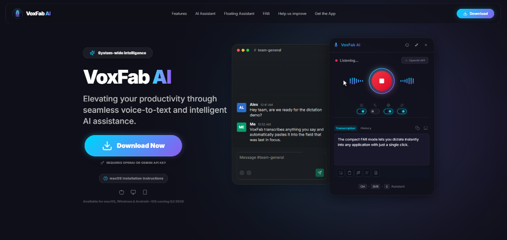
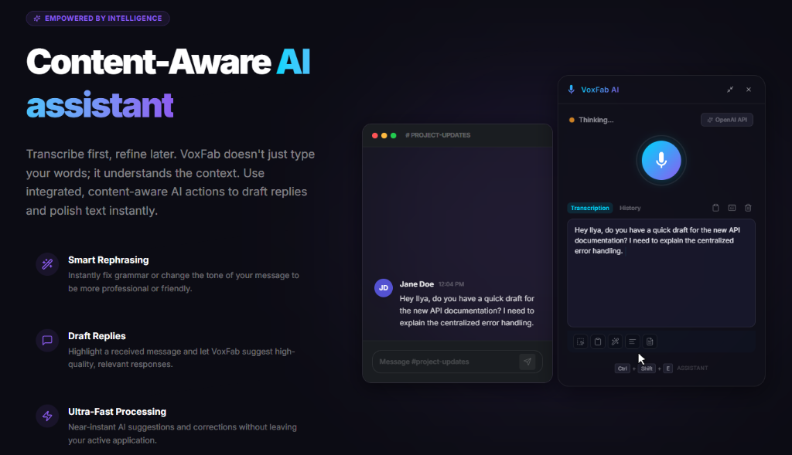
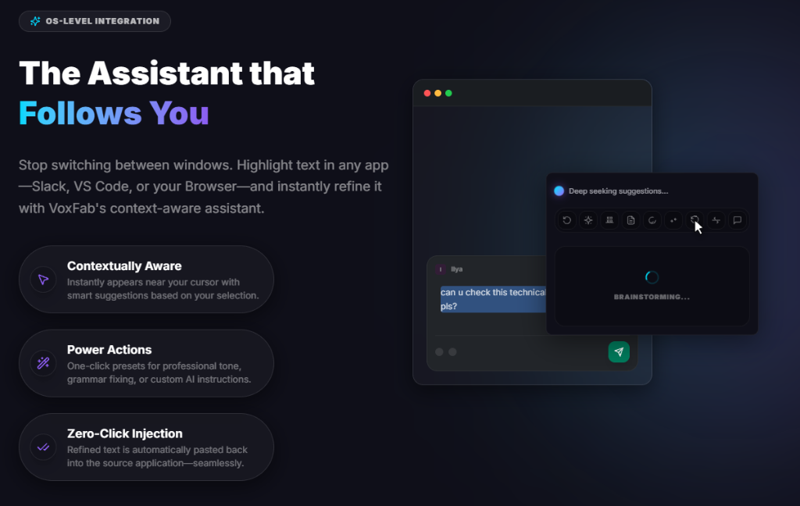
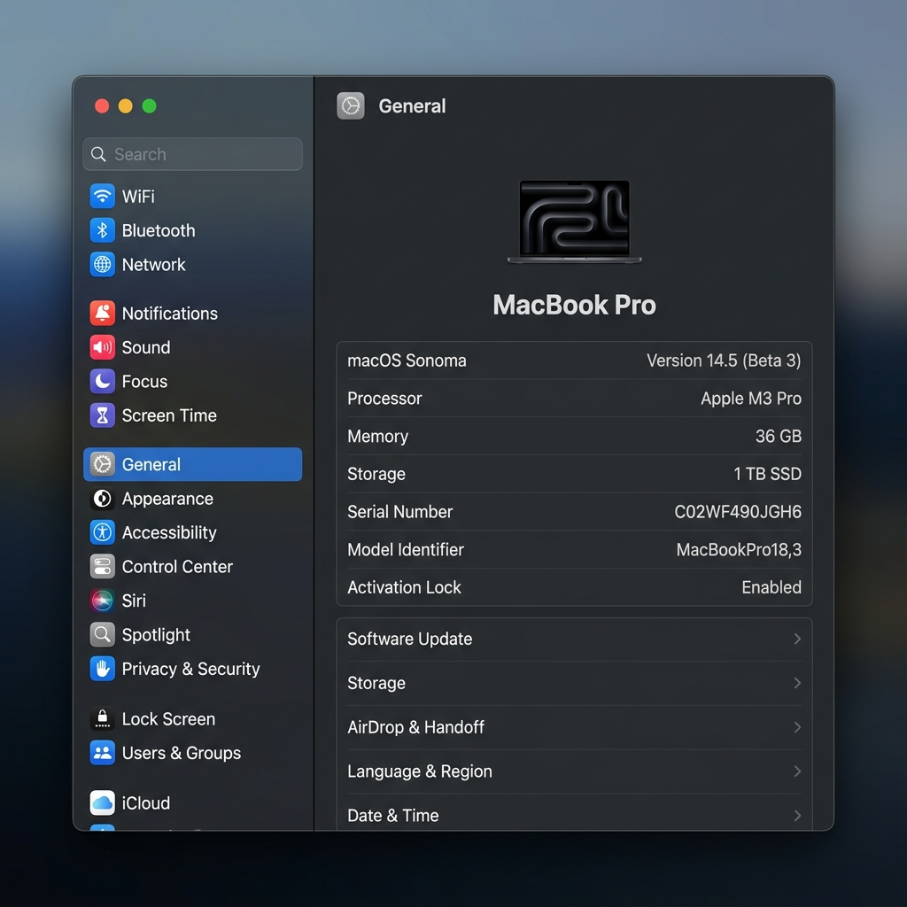
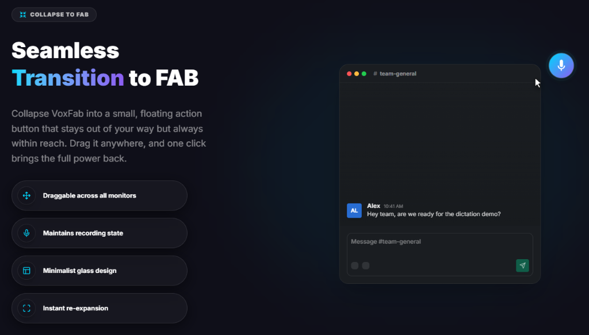
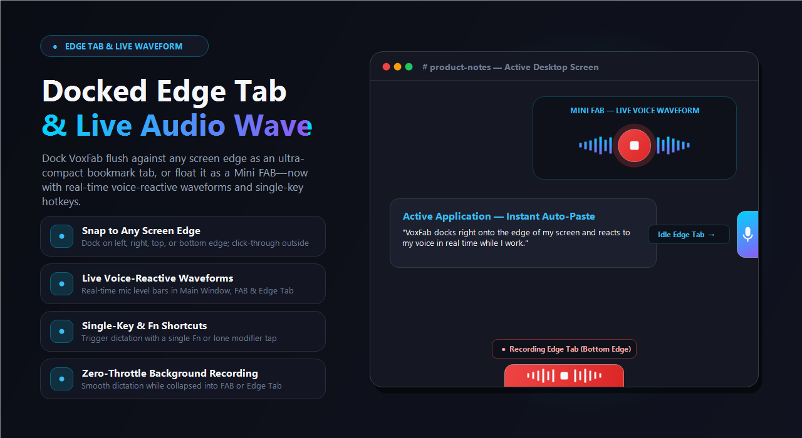

# VoxFab AI 🎙️✨

**Speak into Existence.** VoxFab AI is a super-simple, high-performance dictation productivity tool. Unlike other programs that try to be everything at once, VoxFab focuses on doing exactly one thing perfectly: lightning-fast voice-to-text with a sleek AI assistance overlay to boost your productivity. No bloat, no distractions—just pure speed for your workflow.

[](https://voxfab.app/)
[](LICENSE)



## 📥 Download

Get the latest ready-to-use version of VoxFab AI directly from **GitHub Releases** (Windows Web Installer is under **1 MB** and automatically fetches the runtime during setup).

<a href="https://github.com/icelanderus/VoxFab-AI/releases/latest/download/VoxFab-AI-Web-Setup-1.3.8.exe" target="_blank">
  
</a>
<a href="https://github.com/icelanderus/VoxFab-AI/releases/latest" target="_blank">
  
</a>
<br><br>
<a href="https://drive.proton.me/urls/KNW4V68W3C#N-LUlNjFri86" target="_blank">
  
</a>

## ✨ Features


### 🎙️ System-wide Dictation & Smart Cleanup
Press `Ctrl+Shift+Space` (or `⌘⇧Space`) to record audio and have it typed directly into any active application. VoxFab transcribes anything you say and automatically pastes it into the field that was last in focus.

- **Smart Dictation Cleanup**: Automatically removes filler words, stutters, self-corrections, and off-topic asides, fixes broken sentences and punctuation, and turns spoken enumerations (*"one, two, three"*) into clean numbered lists before pasting—while preserving your exact language, tone, and wording.



### 🤖 AI Writing Assistant
Highlight any text and press `Ctrl+Shift+E` (`⌘⇧E`) to fix grammar, change tone, summarize, or expand your writing using GPT-4. Stop switching between windows; refine text instantly within Slack, VS Code, or your Browser.



### 🖥️ Capture Anything On Your Screen
Not limited to images. VoxFab takes a high-precision capture of any designated screen area and extracts text instantly—from system windows, locked PDFs, or videos.

- **Screen-Wide Capture**: Just drag a box over any part of your screen. VoxFab captures a shot and extracts text from any application or OS setting.
- **Windows & Mac Support**: Full cross-platform compatibility. Get the same high-speed AI extraction performance regardless of your operating system.
- **Beyond Images**: Works with videos, zoom calls, locked documents, or system dialogs. If you can see it, you can capture and extract it.



### 🔘 Mini FAB Mode
Collapse VoxFab into a small, floating action button that stays out of your way but always within reach. Drag it anywhere, and one click brings the full power back—now with real-time voice-reactive waveform bars flanking the button while you speak.



### 📑 Docked Edge Tab & Live Waveforms
Need even less screen footprint? Dock VoxFab flush against any edge of your monitor (**left, right, top, or bottom**) as a sleek bookmark tab:

- **Snap to Any Screen Edge**: Drag the tab smoothly along or across screen edges; clicks outside the tab pass right through to your underlying apps.
- **Real-Time Voice Waveforms**: Live microphone level bars react dynamically to your voice across the Main Window, Floating Mini FAB, and Docked Edge Tab.
- **Single-Key & `Fn` Shortcuts**: Bind a single tap of `Fn` or a lone modifier key (`Right ⌘`, `Right ⌥`, etc.) for instant hands-free dictation.



### 🔒 Privacy Focused
Use local Whisper engines for privacy or connect your own OpenAI API key for maximum accuracy and cloud features.

## 🚀 Getting Started

### Prerequisites
- [Node.js](https://nodejs.org/) (v18 or higher recommended)
- [npm](https://www.npmjs.com/)

### Installation

1. **Clone the repository:**
   ```bash
   git clone https://github.com/icelanderus/VoxFab-AI.git
   cd VoxFab-AI
   ```

2. **Install dependencies:**
   ```bash
   npm install
   ```

3. **Run the application:**
   ```bash
   npm start
   ```

## 📄 License

This project is licensed under the **Creative Commons Attribution-NonCommercial-ShareAlike 4.0 International (CC BY-NC-SA 4.0)**.

- **Attribution**: You must give appropriate credit.
- **Non-Commercial**: You may not use the material for commercial purposes.
- **ShareAlike**: If you remix, transform, or build upon the material, you must distribute your contributions under the same license.

For commercial licensing inquiries, please contact the author.

---
vibe-coded by [Ilya Tsuprun](https://www.linkedin.com/in/ilya-tsuprun) 🤠
